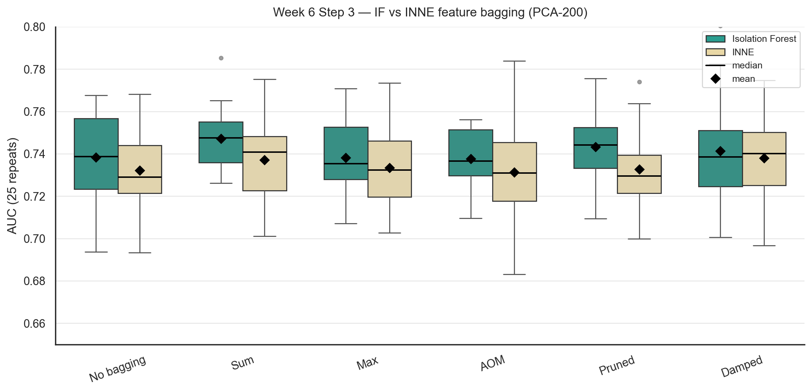

# p53 Mutants: Outlier Detection

Finding p53 mutants that lose the protein's protective function, using unsupervised outlier detection on ~31,000 structure-based mutant profiles. Phase 2 of the Data Science Lab 2026 at KIT (Team 2).

p53 acts as a checkpoint that stops damaged cells from dividing. Mutations that disable it are involved in roughly half of all human cancers. The task is **one-class classification (OCC)**: models are fit on the data without labels. Labels are used only to compute the AUC afterwards, never for `.fit()` or tuning.

## Results

Best OCC model: **Isolation Forest + PCA(200) + StandardScaler + feature bagging (pruned aggregation)**.

| Setting | Model | Validation AUC¹ | Held-out test AUC² |
|---|---|---:|---:|
| OCC | Isolation Forest + PCA(200) + feature bagging (pruned) | **0.7438 ± 0.0199** | **0.8431** |
| OCC | Isolation Forest + PCA(147) + feature bagging (pruned) | 0.7298 ± 0.0198 | 0.8153 |

¹ Mean ± std over 25 repeated random subsamples (inlier-only fit).
² 12 active / 6,139 inactive mutants. With so few actives the test AUC is noisy.

Exploratory only (not OCC, uses labels through SMOTE): GMD + LOF + Random Projection + SMOTE reaches 0.945 test AUC.



## What we did, week by week

| Week | Topic | Key finding |
|---|---|---|
| 1 | Exploration & cleaning | 31,020 → 30,754 rows, 5,408 features (2D surface block + 3D distance block), 61 actives (~503:1) |
| 2 | Dimensionality reduction | Linear methods (PCA, SVD) beat Isomap, UMAP and random projection. Isolation Forest + PCA(147) reaches 0.7291 CV AUC |
| 3 | Method selection | Repeated subsampling as evaluation. Isolation Forest is the best of five detectors. Feature bagging helps slightly |
| 4 | Statistical tests | Friedman + Conover-Iman: the method ranking and the bagging gain are significant. Deep SVDD added |
| 5 | Outlier ensembles | TabPFN is a strong second. V-GAN subspaces give no gain over random ones. Mixing methods is worse than Isolation Forest alone |
| 6 | HPO & high dimensions | 200 PCA components matter more than tuning (0.7248 → 0.7393, bagging: 0.7438). HPO gives no gain for Isolation Forest at 200 dims |

Details, tables and significance results for every week: [docs/FULL_DOCUMENTATION.md](docs/FULL_DOCUMENTATION.md).

## Data

The data was provided by the course supervisors and is **not included** in this repository. Expected files: `train_data.data` (features) and `train_gt.csv` (labels), see [docs/FULL_DOCUMENTATION.md](docs/FULL_DOCUMENTATION.md#data).

## Setup

```bash
git clone https://github.com/Bescher-Kilani/p53-outlier-detection.git
cd p53-outlier-detection
bash setup.sh
source venv/bin/activate
```

TabPFN needs a HuggingFace login and V-GAN needs extra steps, see the full documentation.

## Try it without the real data

`make_synthetic_data.py` creates random data in the same format (5,408 features, a few empty and duplicate rows, ~50:1 imbalance). It shows that the code runs end to end. The numbers are meaningless for the real task.

```bash
python make_synthetic_data.py          # writes synthetic/train_data.data and synthetic/train_gt.csv
cd synthetic
python ../split_data.py                # clean + stratified train/test split
python ../p53_od_pipeline.py --method isolation_forest --reduce pca --n-components 50
python ../p53_od_pipeline.py --feature-bagging --bagging-methods isolation_forest \
    --reduce pca --n-components 50 --n-repeats 5 --n-subsets 5
```

## With the real data

```bash
python split_data.py
python p53_od_pipeline.py --method isolation_forest --reduce pca --n-components 200 \
    --feature-bagging --n-repeats 25 --n-subsets 10
```

`python p53_od_pipeline.py --help` lists all options.

## Repository structure

```text
.
├── p53_od_pipeline.py      # outlier detection pipeline, all experiments via CLI flags
├── split_data.py           # cleaning + stratified train/test split
├── mrmr_ifs.py             # mRMR + IFS feature selection
├── eval_internal_test_auc.py
├── compute_correlations.py
├── pca_2d_3d_blocks*.py
├── benchmark_*.py          # Week 4-6 experiments
├── plot_week6_*.py
├── make_synthetic_data.py
├── notebooks/              # data exploration
├── docs/                   # full documentation
├── outputs/                # AUC matrices and significance tables (predictions are not published)
├── outputs_week5_sig/, week6-tables/   # result tables and plots
├── requirements.txt
└── setup.sh
```

## Authors

Team 2, Data Science Lab 2026, Karlsruhe Institute of Technology.
